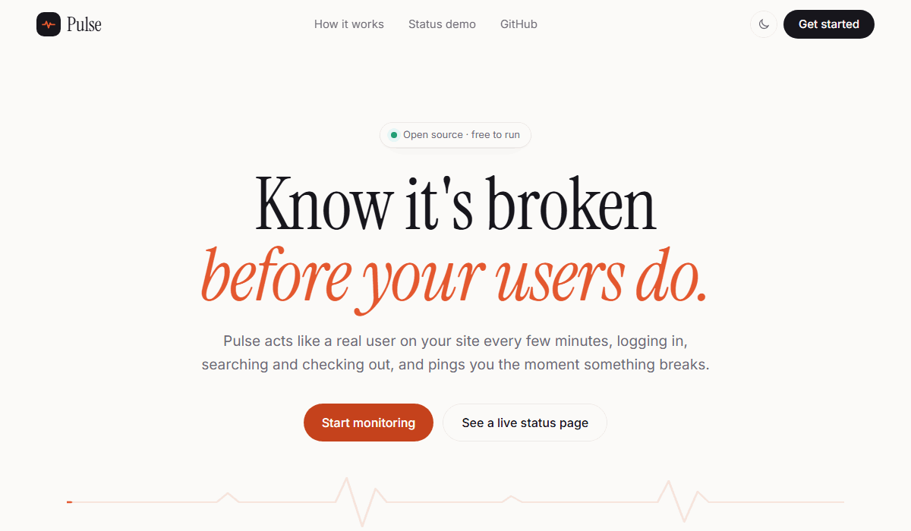
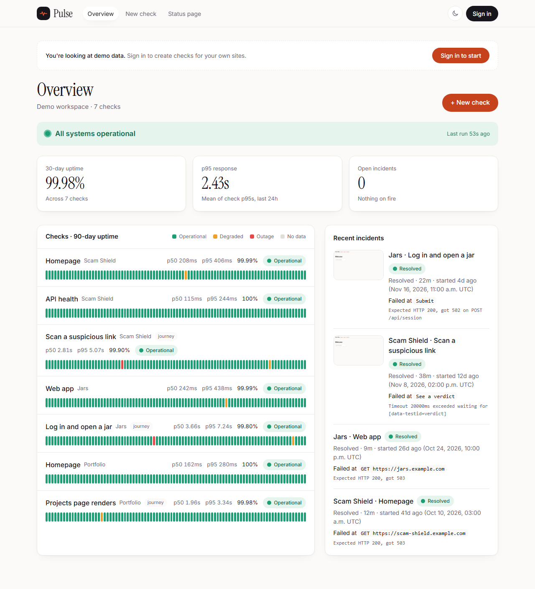
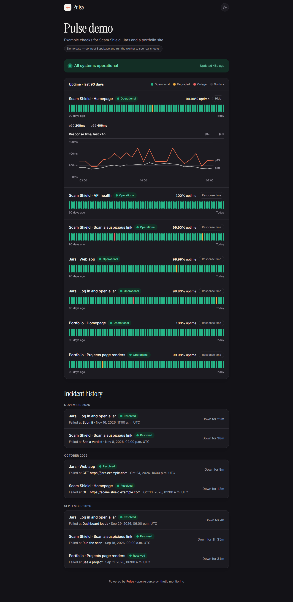
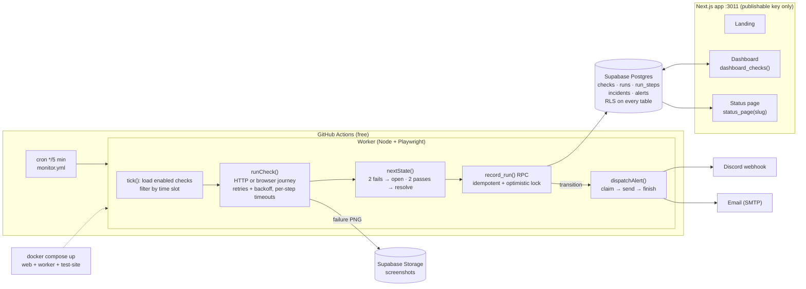

<p align="center">
  
</p>

<h1 align="center">Pulse</h1>

<p align="center">
  <b>Open-source synthetic monitoring.</b> Pulse acts like a real user on your site every few minutes, logging in, searching and checking out, and pings you the moment something breaks.
  <br><br>
  <a href="#quick-start">Quick start</a> · <a href="#architecture">Architecture</a> · <a href="#how-incidents-and-uptime-are-calculated">How the maths works</a> · <a href="#tests">Tests</a>
</p>

---

## The story

During my co-op at **Public Services and Procurement Canada**, I built an RPA monitoring bot that walked through critical services the way a real person would and raised the alarm when a step failed. It **cut outage detection time by 40%**, because we stopped finding out about breakages from the people who were trying to use them.

Pulse is the open-source version of that idea, rebuilt so that anyone can run it for **free**:

- a simple URL check or a full **Playwright user journey** (open the site → log in → search → add to cart),
- run on a schedule by **GitHub Actions cron** (no server running 24/7),
- stored in **Supabase Postgres** (free tier) with Row Level Security on every table,
- with **incidents**, **Discord + email alerts with screenshots of the failing step**, a **public status page** and a **dashboard**.

## Features

| | |
|---|---|
| **Two kinds of checks** | HTTP (status code + response-time budget) or a Playwright journey, built in the dashboard's step builder or written as code in `apps/worker/journeys/*.ts`. |
| **No false alarms** | Retries with exponential backoff and jitter inside each run, a timeout on every step, and an incident only opens after **2 consecutive failed runs** (and resolves after **2 passes**). |
| **Screenshots of the break** | When a step fails, the page is screenshotted, uploaded to Supabase Storage, attached to the Discord/email alert and kept on the incident. |
| **Exactly-once recording & alerts** | Runs are keyed per check and time slot (`UNIQUE idempotency_key`), state changes are guarded with optimistic locking, and alerts are claimed through a dedup table, so a retried job never double-counts or double-pings. |
| **Honest uptime, in SQL** | Uptime is based on time, not run counts: incident intervals are merged with `range_agg` so overlapping incidents never double-count downtime. p50 and p95 come from `percentile_cont`. |
| **Status pages** | Public page per project: current status, 90-day uptime bars, p50/p95 response-time chart, incident history. |
| **Polished UI** | Next.js + Tailwind + Framer Motion, dark mode, mobile-friendly, WCAG AA contrast, keyboard-accessible charts, and `prefers-reduced-motion` stops all animation. |

<p align="center">
   
</p>

## Architecture



| Path | What it is |
|---|---|
| `packages/core` | Pure, fully unit-tested logic: incident state machine, uptime & percentile maths, alert dedup, retry/backoff/timeouts, slot-based idempotency, journey validation. |
| `apps/worker` | Scheduler + runners (HTTP via `fetch`, journeys via Playwright), Supabase store, Discord & email notifiers, CLI (`--once` for cron, long-running loop for Docker). |
| `apps/web` | Next.js 16 app: landing page, dashboard, check editor, public status pages. |
| `apps/test-site` | "Acme Shop", a tiny local site whose health you can switch between `up`, `down`, `broken-search` and `slow`. Used by the integration tests and the Docker demo. |
| `supabase/migrations` | Schema, RLS policies, SQL analytics (uptime and percentiles), `record_run` / `claim_alert` functions, storage bucket. |
| `supabase/seed.sql` | Example checks for **Scam Shield**, **Jars** and **Portfolio** (placeholder URLs, so search for `REPLACE`). |

### Security model

- The browser only ever sees the **publishable key**. Every table has **RLS** enabled. Owners can read their own data and edit check configuration, but can't touch state-machine columns or write runs, incidents or alerts.
- The public status page never queries tables directly. It calls the `security definer` function `status_page(slug)`, which returns only presentation-safe fields (no URLs, journey steps, raw errors or screenshots) for projects marked public.
- The **secret key** is used only by the worker (`.env.local` locally, a GitHub Actions secret in CI). `record_run`, `claim_alert` and `finish_alert` can only be executed by `service_role`.
- Journey secrets (test-account passwords) are never stored in the database. Steps reference them as `{{env.JARS_TEST_PASSWORD}}` and the worker fills them in from environment variables / GitHub secrets.

## How incidents and uptime are calculated

### The run

1. Each check runs once per **time slot** (`floor(now / interval)`). The run's idempotency key is `check_id:slot_start`.
2. Inside a run, a failed attempt is retried up to `retries` times with **exponential backoff and jitter** (2s, 4s, … capped at 15s). The run only counts as **failed if every attempt fails**.
3. Every journey step has its own **timeout** (Playwright's timeout plus a hard `withTimeout` cap). The first failing step is **screenshotted**.

### The state machine (`packages/core/src/incident.ts`)

```
           pass                     fail                  fail (2nd in a row)
 unknown ───────▶ up ◀───────┐  up ───────▶ up(1 fail) ─────────────────────▶ DOWN  → incident opened, alert
                             │
                             └──── pass (2nd in a row) ◀── down(1 pass) ◀── pass ── DOWN  → incident resolved, alert
```

- **Opened** after 2 consecutive failed runs. **Resolved** after 2 consecutive passes. Flapping (fail, pass, fail, pass…) never opens anything.
- The **incident starts at the first failed run** of the streak and **ends at the first passing run** of the recovery, so durations reflect the real outage, not the confirmation delay.
- The worker computes the transition in TypeScript. `record_run()` applies it atomically in one transaction:
  - It inserts the run with `ON CONFLICT (idempotency_key) DO NOTHING`. A duplicate returns immediately and changes **nothing**.
  - It updates the check `WHERE state_version = expected`. If another worker got there first, it raises `state_conflict` and the whole transaction rolls back. The worker then re-reads and retries.
  - A partial unique index guarantees at most **one open incident per check**.

### Alerts

The dedup key is `incident_id:kind:channel`. Before sending, the worker **claims** the key (`INSERT … ON CONFLICT DO UPDATE … WHERE status = 'failed'`). Only the claimer sends. A failed send marks the claim `failed`, so the next tick retries it; a successful send marks it `sent` forever.

### Uptime (`supabase/migrations/0003_analytics.sql`)

Uptime is **time-based**:

```
uptime(window) = 1 − downtime(window) / monitored(window)
```

- **downtime** is the union of incident intervals (open incidents run up to *now*), merged with `range_agg` and intersected with the window using multirange `*`. Overlapping incidents are never counted twice.
- **monitored time** starts at the check's first run. A check created at noon isn't penalised for the morning, and days before it existed show as *no data* (grey bars).
- Daily bars: one UTC-day window per bar for 90 days (`check_daily_uptime`). Green is ≥ 99.9%, amber ≥ 95%, red below that.
- **p50 / p95** come from `percentile_cont(0.5 | 0.95) WITHIN GROUP (ORDER BY duration_ms)` over **passing** runs, so a timeout doesn't skew latency. Hourly buckets for charts use `date_bin`.

The same definitions are implemented in TypeScript (`packages/core/src/uptime.ts`), and the SQL test suite asserts that **both produce identical numbers**.

## Tests

```
npm test
```

```
 ✓ unit         packages/core/test/incident.test.ts           13 tests   state transitions, flapping, thresholds
 ✓ unit         packages/core/test/uptime.test.ts             19 tests   interval merging, uptime %, daily buckets, percentiles
 ✓ unit         packages/core/test/alerts.test.ts              7 tests   dedup, concurrency, retry after failure
 ✓ unit         packages/core/test/retry-schedule.test.ts     16 tests   backoff, timeouts, slots/idempotency, journey validation
 ✓ unit         apps/worker/test/unit/worker.test.ts           6 tests   alert payloads, secret interpolation, idempotent recording
 ✓ integration  apps/worker/test/integration/...test.ts        9 tests   real Playwright vs a site toggled up/down/broken/slow
 ✓ sql          supabase/tests/migrations.test.ts             14 tests   RLS, record_run, claim_alert, SQL == TS maths

 Test Files  7 passed (7)
      Tests  84 passed (84)
```

- **Integration test.** It starts the Acme Shop test site and runs a real Chromium journey: log in → search → add to cart → check the cart count. It then breaks the search button and checks that Pulse:
  - pinpoints the failing step and saves a real PNG screenshot,
  - opens an incident only on the second failure, and alerts exactly once,
  - ignores a replayed job,
  - resolves after two passes, with the correct outage duration.
- **SQL test.** It applies the real migrations to Postgres 17 (Docker locally, a service container in CI) with a small stub of Supabase's `auth` schema. It then checks RLS, idempotency, optimistic locking, incident attribution and alert claims, and that the SQL uptime and percentile numbers match the TypeScript ones.
- **CI** (`.github/workflows/ci.yml`) runs the typecheck, all three test projects and a production build of the web app.

## Quick start

```bash
npm install
npx playwright install chromium
npm test                      # 84 tests (the SQL suite needs Docker running)
npm run build && npm start -w @pulse/web   # http://localhost:3011
```

With no database configured, the landing page, `/dashboard` and `/status/demo` show realistic demo data.

### Watch an incident happen locally (no Supabase needed)

```bash
npm run test-site             # Acme Shop on http://localhost:3012
npx tsx apps/worker/src/cli.ts --dry-run   # in-memory store, ticks every minute
# open http://localhost:3012/__pulse and click "broken-search"; two ticks later an incident opens
```

### Or everything in Docker

```bash
docker compose up --build     # web :3011, worker, test-site :3012
```

## Setup with Supabase

1. **Run the migrations.** In the Supabase SQL editor, run `supabase/migrations/0001…0005` in order (or `supabase db push` with the Supabase CLI).
2. **Turn on email sign-in.** Authentication → Providers → Email. Add `http://localhost:3011/dashboard` (and your deployed URL) to the redirect URLs.
3. **Sign in** at `/login` (magic link). Then edit the placeholder URLs in `supabase/seed.sql` and run it, which creates the Scam Shield, Jars and Portfolio projects and checks for you.
4. **Configure the worker.** Add `SUPABASE_SECRET_KEY` to `.env.local` (server only; it's gitignored).
5. **Schedule it for free.** Push to GitHub and add these to *Settings → Secrets and variables → Actions*:

| Name | Type | Value |
|---|---|---|
| `SUPABASE_SECRET_KEY` | secret | Supabase → Project Settings → API keys → secret key |
| `SUPABASE_URL` | variable | `https://<project>.supabase.co` |
| `DISCORD_WEBHOOK_URL` | secret | Discord → channel → Edit Channel → Integrations → Webhooks → New Webhook → Copy URL |
| `SMTP_URL` | secret | e.g. `smtps://you%40gmail.com:<app-password>@smtp.gmail.com:465` (Gmail app password) |
| `ALERT_EMAIL_FROM` / `ALERT_EMAIL_TO` | variables | sender / recipient |
| `PUBLIC_APP_URL` | variable | where the web app is deployed (for status-page links in alerts) |
| `JARS_TEST_EMAIL` / `JARS_TEST_PASSWORD` | secrets | test-account credentials used by the Jars journey |

`monitor.yml` then runs every 5 minutes (GitHub's minimum) and uploads failure screenshots as build artifacts.

## Writing journeys

**In the dashboard:** use the step builder (`goto`, `click`, `fill`, `press`, `select`, `check`, `expectVisible`, `expectText`, `expectUrl`, `wait`). Each step can have its own timeout, and steps can be reordered by dragging.

**As code:** add `apps/worker/journeys/<name>.ts` and set the check's script name to `<name>`:

```ts
import type { CodeJourney } from "../src/runners/browser";

const journey: CodeJourney = async ({ page, step, baseUrl, env }) => {
  await step("Open login", () => page.goto(`${baseUrl}/login`));
  await step("Log in", async () => {
    await page.getByLabel("Email").fill(env.JARS_TEST_EMAIL!);
    await page.getByLabel("Password").fill(env.JARS_TEST_PASSWORD!);
    await page.getByRole("button", { name: "Log in" }).click();
  });
  await step("Dashboard loads", () => page.getByTestId("jars-list").waitFor(), { timeoutMs: 10_000 });
};
export default journey;
```

## Tech stack

- **Worker:** Node.js 22, TypeScript, Playwright (Chromium), `fetch`, Nodemailer, Supabase JS
- **Web:** Next.js 16 (App Router), React 19, Tailwind CSS, Framer Motion, Instrument Serif + Inter
- **Data:** PostgreSQL on Supabase (free tier): RLS, `range_agg` multiranges, `percentile_cont`, `date_bin`, plpgsql, Storage
- **Scheduling:** GitHub Actions cron (free) or Docker Compose
- **Testing:** Vitest (unit, integration with real Playwright, SQL against real Postgres), GitHub Actions CI

## Design

Warm off-white `#FBFAF8`, near-black `#17161C`, coral `#E4572E`, muted grey `#6B6875`, white cards with a `#ECE9E4` border and 14px radius. Status colours (green `#1D9E75`, amber `#EF9F27`, red `#E24B4A`) are only ever used for meaning, and always alongside a text label.

For WCAG AA, coral `#E4572E` is used for large and decorative elements (the headline italic, the heartbeat line, chart strokes). Small coral text and the white-text coral button use a slightly deeper tone (`#C5421C`), because white on `#E4572E` is only 3.7:1. In the same way, status text on tinted banners uses darker "ink" shades of each status colour.

## License

MIT
